# Квартирник — домены и C4

| | |
|---|---|
| Документ | Черновик архитектуры бэкенда |
| Статус | Draft |
| Опора | PRD, SRS |

Черновик. Уровень кода C4 не фиксируется: сервисов ещё нет.

Двенадцать доменов. Бывшая квартира разрезана на шесть из них. У каждого домена свой сервис на Go и своя Postgres. Клиенты ходят только в `api-gateway`. Факты между доменами везёт NATS JetStream (3 узла). Очередь задач домена — River в его же Postgres. Байты лежат в S3.

Платёж квартиры — отметка месяца, не перевод денег. Подписка Premium — отдельный домен. Канал входа в SRS не задан: в черновике это телефон и одноразовый код.

## Домены

Домен — кусок правил со своим языком и своей базой. Сервис другого домена не читает его таблицы. Общий идентификатор квартиры — UUID, который выдаёт паспорт при создании.

`api-gateway`, JetStream, River, S3 и Postgres доменами не являются: это край, шина, очередь, байты и диск.

Паспорт хранит квартиру, комнаты и технику. Учёт хранит счётчики и показания. Календарь хранит задачи. Платежи хранят отметку месяца. Документы хранят архив и видимость. История собирает ленту Premium из чужих фактов и сама источник не переписывает. Уход нанимателя ничего не удаляет: `membership` увеличивает поколение, а документы фильтруют чтение.

### Ядро квартиры

| Домен | Сервис | Агрегаты | Инвариант |
|---|---|---|---|
| Доступ | `membership` | Сторона, участие, приглашение | Один owner на сторону. Человек не стоит на обеих сторонах одной квартиры |
| Паспорт | `passport` | Квартира, комната, техника | Техника привязана к комнате или лежит на квартире без комнаты |
| Учёт | `metering` | Счётчик, показание | Одно актуальное показание на счётчик и календарный месяц |
| Календарь | `calendar` | Задача | Задача показания висит, пока за этот месяц нет показания. Задача платежа висит, пока месяц не закрыт |
| Платежи | `payments` | Месячный платёж | При двух сторонах месяц закрывает только арендодатель. Денег система не переводит |
| Документы | `documents` | Документ | Видимость «обе стороны» или «только моя сторона», с учётом поколения нанимателя |
| История | `history` | Запись ленты | Запись дописывается всегда, на базе не показывается. Уход нанимателя её не стирает |

### Вход, подписка и доставка

| Домен | Сервис | Агрегаты | Инвариант |
|---|---|---|---|
| Идентичность | `identity` | Пользователь, сессия, устройство | Access JWT живёт 15 минут и проверяется на gateway без вызова identity |
| Подписка | `billing` | Entitlement, чек магазина | Наниматель при живом арендодателе Premium не покупает. Чек магазина уникален |
| Файлы | `media` | Объект | SHA-256 совпадает с байтами. Файл не перекодируется. Скачивание повторно проверяет доступ |
| Уведомления | `notification` | Настройка типов, доставка | Один пуш на пользователя, задачу, локальный день и тип |
| Сторис | `content` | Карточка | Ровно четыре готовые карточки. Текст пользователь не меняет |

### Кто кого вызывает синхронно

Синхронный вызов значит: без ответа команда клиенту не подтверждается. Таймаут короткий. Повтор безопасен за счёт `Idempotency-Key`.

| Откуда | Куда | Зачем |
|---|---|---|
| Приложение | `api-gateway` | Единственный HTTPS-вход |
| gateway | домен маршрута | gRPC, без бизнес-правил на краю |
| Любой домен квартиры | `membership` | `Authorize`. Нет ответа — ошибка, данные не отдаются |
| `passport` | `membership` | `ClaimOwner` при создании квартиры: слот лимита и owner в одной критической секции |
| `membership` | `billing` | Premium, прежде чем пустить второго человека на сторону |
| `passport` | `billing` | Лимит 1 или 5 квартир перед созданием |
| `history` | `billing` | Показать ленту или экран покупки |
| `metering`, `payments`, `documents` | `media` | Резерв объекта и подтверждение байтов |
| `media` | `membership` | Повторная проверка прав на каждый скачиваемый байт |
| `billing` | `membership` | Перед магазином: есть ли уже арендодатель |
| `calendar`, в день срока | `membership` | Кому слать пуш прямо сейчас, а не по старому списку |
| `notification` | `identity` | Токены устройств в момент отправки |
| `identity` | SMS | Одноразовый код |
| `billing` | App Store, Google Play | Проверка чека |
| `notification` | APNs, FCM | Доставка пуша |
| `media` | S3 | Байты приватного бакета |

### Какие факты едут событием

Событие пишется в outbox той же транзакцией, что и факт. Publisher River относит его в JetStream. Получатель ведёт inbox: вторая доставка пустая.

| Событие | Источник | Кто слушает | Что делает слушатель |
|---|---|---|---|
| `meter.registered` | `metering` | `calendar` | Открывает задачу показания на текущий месяц |
| `reading.committed` | `metering` | `calendar` | Закрывает задачу этого счётчика. Другие счётчики не трогает |
| `payment.settled` | `payments` | `calendar`, `history` | Закрывает задачу платежа. История дописывает подтверждённый месяц |
| `appliance.replaced` | `passport` | `history` | Дописывает замену техники |
| `maintenance.completed` | `calendar` | `history` | Дописывает выполненное обслуживание |
| `document.dated` | `documents` | `calendar` | Ставит напоминание за 14 дней или снимает его |
| `task.due` | `calendar` | `notification` | Просит один пуш. Получателей calendar уже узнал у membership |
| `object.committed` / `object.rejected` | `media` | домен, который резервировал файл | Показание, платёж или документ становится видимым только после проверки байтов |
| `device.changed` | `identity` | `notification` | Не обязателен: токены читаются в момент отправки. Событие оставлено как запасной путь |

Закрытие задачи больше не в той же транзакции, что и показание. Источник правды — учёт. Календарь догоняет событием и сверкой месяца. Если экран обязан гасить задачу в том же ответе, учёт и календарь склеиваются обратно.

## C1. Система и окружение

Квартирник для телефона — одна система. Внутри неё домены, снаружи только чужие API: код входа, пуши и чек магазина. Пользователь к Postgres, JetStream и S3 не подключается.

| Актор или система | Отношение к Квартирнику | Граница версии |
|---|---|---|
| Арендодатель, наниматель, жилец-владелец | Роли внутри доступа, не отдельные системы | Один человек может быть арендодателем в одной квартире и нанимателем в другой |
| iOS и Android | Единственные клиенты | Веб-клиента и офлайн-протокола нет |
| SMS | Код входа для identity | Госуслуги и УК не входят |
| APNs и FCM | Доставка пуша, если телефон разрешил | Задача в календаре от пуша не зависит |
| App Store и Google Play | Чек Premium для подписки | Эквайринг аренды нет |

## C2. Контейнеры

Контейнер здесь — процесс, который можно выкатить отдельно, и его база. У домена два процесса одного бинаря: API и worker. Worker забирает задачи River из Postgres этого же домена. Общей базы нет.

Сплошная стрелка — синхронный вызов. Пунктир — событие после коммита: outbox, JetStream, inbox.

| Контейнер | База | Процессы | Снаружи |
|---|---|---|---|
| `api-gateway` | нет | API ≥ 2 | единственный ingress |
| `identity` | своя Postgres | API ≥ 2, worker | SMS |
| `billing` | своя Postgres | API ≥ 2, worker | App Store, Google Play |
| `membership` | своя Postgres | API ≥ 2, worker | нет |
| `passport` | своя Postgres | API ≥ 2, worker | нет |
| `metering` | своя Postgres | API ≥ 2, worker | нет |
| `payments` | своя Postgres | API ≥ 2, worker | нет |
| `documents` | своя Postgres | API ≥ 2, worker | нет |
| `calendar` | своя Postgres | API ≥ 2, worker | нет |
| `history` | своя Postgres | API ≥ 2, worker | нет |
| `media` | своя Postgres | API ≥ 2, worker | S3 |
| `notification` | своя Postgres | API ≥ 2, worker | APNs, FCM |
| `content` | своя Postgres | API ≥ 2 | нет |
| NATS JetStream | поток на диске узлов | 3 узла | клиенты не подключаются |

Kubernetes, снаружи открыт только gateway. У каждой Postgres primary и синхронный standby, плюс восстановление на точку времени. API ходит в базу через PgBouncer в режиме транзакций. Worker River подключается напрямую: очередь держит сессионную блокировку, пулер транзакций её рвёт. Экран арендодателя собирает gateway: список квартир из `membership`, статусы месяца из `metering` и `payments`.

Полосы вызова сверху вниз:

1. Телефоны iOS и Android.
2. `api-gateway`: подпись JWT, лимит частоты, маршруты, склейка экрана арендодателя. Своей базы нет.
3. `identity` и `billing`.
4. `membership`: стороны, owner, приглашение на 7×24 часа, поколение нанимателя.
5. Шесть доменов квартиры: `passport`, `metering`, `payments`, `documents`, `calendar`, `history`.
6. JetStream и River.
7. `media`, `notification`, `content`.

## C3. Компоненты разрезанной квартиры

У каждого домена с событиями внутри одни и те же технические компоненты: API, транзакция Postgres, outbox, inbox, worker River. Ниже только правила.

| Домен | Компоненты правил | Что специально не хранит |
|---|---|---|
| `membership` | `Authorize`, приглашение, передача owner, закрытие стороны, поколение | Комнаты, файлы, задачи |
| `passport` | Квартира в статусе provisioning, затем active; комнаты; замена техники | Кто owner: это спрашивается у membership |
| `metering` | Тип счётчика, upsert показания месяца, привязка фото | Закрытую задачу календаря |
| `payments` | Взнос одной стороны, чек, подтверждение арендодателя | Движение денег и чек магазина Premium |
| `documents` | Тип, видимость, дата окончания, фильтр поколения | Сами байты |
| `calendar` | Проекции счётчиков и платежей, открытие месяца, день срока | Число показания и сумму платежа |
| `history` | Дописывание ленты из inbox, выдача только при Premium | Исходные комнаты и задачи |
| `media` | Резерв, проверка размера и типа, стрим скачивания | Кому документ виден по правилам квартиры |

### Сдать показание

| Шаг | Домен | Результат |
|---|---|---|
| 1 | Приложение | Число, дата, необязательное фото. Повтор после обрыва сети идёт с тем же `Idempotency-Key` |
| 2 | gateway | Подпись JWT. В identity этот запрос не ходит |
| 3 | `metering` → `membership` | Сдавать может сторона нанимателя. Если нанимателя нет — сторона жильца |
| 4 | `media`, если есть фото | Резерв и presigned PUT. Телефон кладёт байты в S3. JPG или PNG, до 20 МБ |
| 5 | `metering`, одна транзакция | Одна строка на счётчик и месяц, outbox `reading.committed`. Ответ «сохранено» ставится здесь |
| 6 | `calendar` | Inbox закрывает задачу этого счётчика. Пока событие в пути, задача ещё видна. Повторный прогон месяца её тоже закрывает |

С фото шаг 5 ждёт `object.committed`. Оборванная загрузка не выглядит как сданное показание, задача остаётся открытой.

### Закрыть сторону нанимателя

| Шаг | Домен | Результат |
|---|---|---|
| 1 | `membership` | Только owner арендодателя. В одной транзакции отзывает участия нанимателей и увеличивает поколение |
| 2 | `passport`, `metering`, `payments`, `history` | Своих строк не удаляют. Следующий `Authorize` для ушедших уже отказ |
| 3 | `documents` | На чтении: документ «обе стороны» старого поколения видит арендодатель и не видит новый наниматель. «Только моя сторона» ушедшего поколения не видит никто |
| 4 | `calendar` | В день срока список получателей пустой для закрытой стороны, пуш им не ставится |

### День срока

Worker календаря раз в минуту выбирает задачи, у которых дата срока наступила и пуш ещё не запрошен. Для каждой узнаёт пользователей у `membership`, затем пишет событие `task.due`. `notification` ставит доставку с уникальным ключом и шлёт её в APNs или FCM с тем же ключом как collapse id. Выключенный тип в доставку не попадает. Следующий день сам по себе новый пуш не создаёт: у задачи один день срока.

## Отказ домена

Падает один домен и его база. Остальные отвечают на свои команды. Команда, которой нужен упавший сосед синхронно, возвращает ошибку и не помечает операцию выполненной.

| Не отвечает | Что видит пользователь | Что уже правда в базах |
|---|---|---|
| `membership` | Квартира не открывается | Чужие комнаты и файлы не отдаются из копии |
| `billing` | Новая квартира сверх лимита, второй участник и лента истории не проходят | Уже созданный паспорт читается |
| `metering` | Показание не сохраняется | Задача в календаре остаётся открытой |
| `calendar` | Показание сохранено, задача закроется, когда календарь разберёт событие | Число показания уже в metering. Повторный прогон месяца догоняет задачу |
| JetStream | Команды доменов проходят | Outbox копится в Postgres источника, publisher повторяет |
| S3 или `media` | Файл не подтверждается | Показание без фото сохранить можно. С фото — нельзя |
| `notification` или пуш-провайдер | Пуш задерживается | Задача в календаре на месте. Повтор в тот же локальный день второй пуш не создаёт |
| Postgres одного домена | Молчит только этот домен, пока standby не станет primary | Чужие домены работают на своих базах |

## Словарь платформы

### Raft

Raft — способ договориться нескольким узлам, у кого сейчас верная копия журнала. Узлы выбирают лидера. Запись считается принятой, когда её подтвердило большинство, для трёх узлов это двое. Лидер упал — оставшиеся выбирают нового и продолжают с последней принятой записи, без дырки посередине журнала.

В Квартирнике Raft внутри кластера JetStream. Поток событий лежит на трёх узлах. Смерть одного узла поток не стирает. Доменные сервисы Raft сами не реализуют: им достаточно ответа брокера «сообщение принято».

### River

River — библиотека очереди задач для Go. Очередь живёт таблицами в Postgres того сервиса, который работу породил. Задачу можно вставить в той же SQL-транзакции, что и показание или строку outbox: если транзакция откатилась, задачи тоже нет. Несколько воркеров забирают разные строки блокировкой `SKIP LOCKED`, одну и ту же задачу два воркера не делают. Есть повтор, отложенный запуск и расписание.

Отдельного кластера у River нет. У календаря своя очередь в своей базе, у уведомлений своя. API ходит в Postgres через пулер, воркер River — напрямую.

River внутри домена: открыть задачи месяца, дослать outbox, повторить пуш, снять просроченный резерв файла, дочистить приглашение.

### NATS JetStream

NATS — брокер сообщений. Сервис публикует сообщение в тему, другие сервисы на эту тему подписываются. Без JetStream получатель, который в этот момент не слушает, сообщение пропускает. JetStream дописывает сообщения в поток на диске. Получатель читает в своём темпе и подтверждает обработку. Упал посередине и не подтвердил — сообщение придёт снова. Несколько реплик одного домена делят поток между собой.

Кластер из трёх узлов хранит поток через Raft. После нескольких неудачных обработок сообщение копируется в отдельный поток DLQ, чтобы один битый факт не крутился вечно. Телефон к NATS не подключается. Домен не шлёт в брокер из обработчика HTTP: сначала коммит Postgres вместе с outbox, потом publisher River дописывает поток.

JetStream между доменами: «показание сдано», «платёж закрыт», «технику заменили», «у документа появилась дата». Слушатель может отстать. Факт в базе источника от этого не откатывается.

## RabbitMQ и соседние инструменты

RabbitMQ третьим компонентом не ставим. Он умеет то же, что JetStream: принять факт, хранить его, пока слушатель не подтвердит, раздать нескольким воркерам и сложить неудачное в DLQ. В транзакцию Postgres он не входит, поэтому River он не заменяет. Имеет смысл либо оставить JetStream, либо поставить RabbitMQ вместо него.

### Брокеры между доменами

| Инструмент | Как хранит сообщение | Для Квартирника |
|---|---|---|
| NATS JetStream | Поток на диске, можно перечитать, пока не истекло хранение | Берём. Журнал фактов, три узла, Raft |
| RabbitMQ | Очередь. После подтверждения сообщения в ней нет. Надёжная очередь тоже на Raft | Может заменить JetStream. Рядом с ним не нужен |
| Kafka или Redpanda | Длинный журнал, порядок по ключу квартиры | Та же гарантия, что у JetStream, при нашем объёме тяжелее в эксплуатации |
| Redis Streams | Журнал в памяти с дозаписью на диск | Отдельный кластер слабее, чем Postgres и quorum-очередь |
| Облачная очередь | Чужая очередь, обычно без перечитки истории | Имеет смысл только если вся платформа уже в этом облаке |

### Очереди задач внутри домена

| Инструмент | Где лежат задачи | Для Квартирника |
|---|---|---|
| River | Таблицы Postgres этого домена, в той же транзакции | Берём |
| Asynq | Redis | Удобен в Go. Задача появляется отдельным шагом, не вместе со строкой показания |
| Machinery | RabbitMQ, Redis или облачная очередь | Воркер поверх брокера. Транзакцию Postgres не закрывает |
| RabbitMQ как очередь работ | Очередь брокера, отложка отдельным плагином | Тот же разрыв: сначала коммит, потом публикация. Дыру закрывает только outbox |
| Temporal | Свой кластер процессов и таймеров | Нужен для длинных саг. Наши шаги короткие: outbox и inbox |
